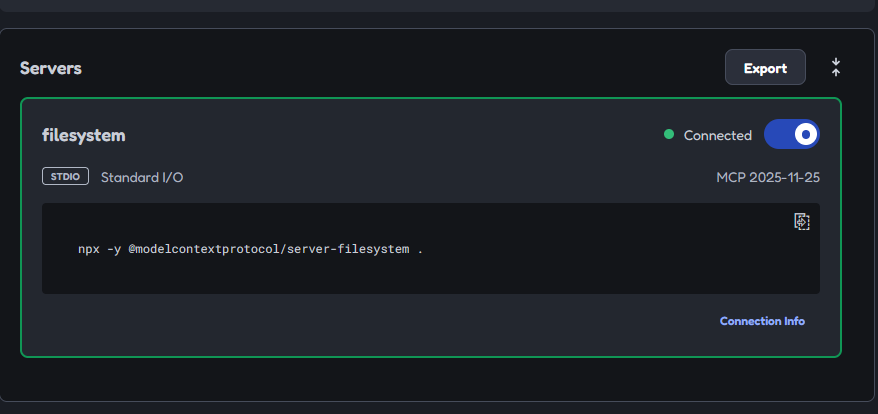
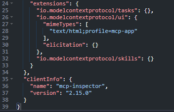
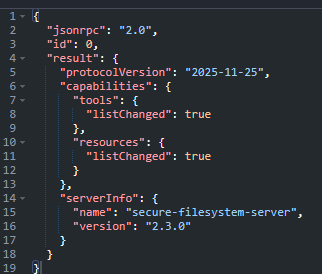
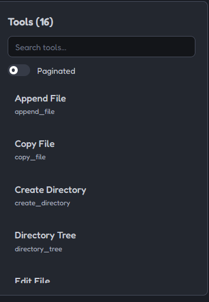
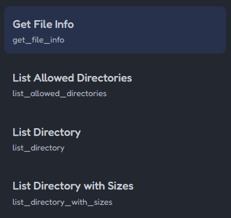
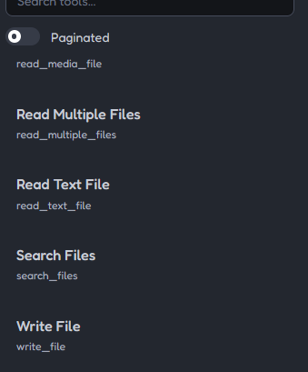
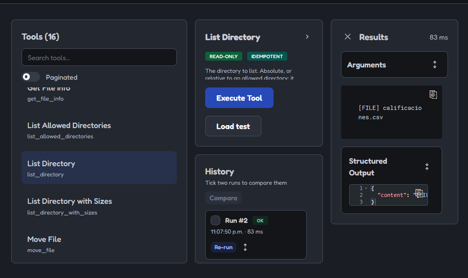
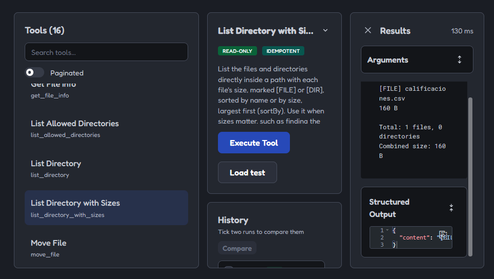

# Práctica 2: Inspección y Pruebas con MCP Inspector y Cliente Personalizado

## Contexto y Configuración Inicial

En esta práctica se profundiza en el funcionamiento interno del protocolo **Model Context Protocol (MCP)** mediante dos enfoques:
1. **Actividad A:** Inspección y prueba interactiva a través de la herramienta oficial **MCP Inspector**.
2. **Actividad B:** Construcción y análisis de un **Cliente MCP Mínimo** en Node.js puro usando transporte `stdio`.

### 1. Estructura del Proyecto
El proyecto se organizó con la siguiente estructura de directorios:
```text
practica2-mcp/
├── datos/
│   └── calificaciones.csv         # Conjunto de datos de prueba
├── evidencias/                   # Capturas de pantalla del MCP Inspector
├── salida/
│   ├── historial_inspector.json  # Historial exportado desde MCP Inspector
│   └── traza.jsonl               # Traza completa de mensajes de cliente_mcp.mjs
├── cliente_mcp.mjs               # Cliente MCP mínimo en Node.js por stdio
├── mcp.json                      # Configuración del servidor MCP
└── README.md                     # Documentación de la práctica
```

### 2. Configuración del Servidor Filesystem (`mcp.json`)
Se configuró el servidor oficial de sistema de archivos para acceder al directorio actual (`.`):
```json
{
  "mcpServers": {
    "filesystem": {
      "command": "npx",
      "args": ["-y", "@modelcontextprotocol/server-filesystem", "."]
    }
  }
}
```

---

## Actividad 1 (Actividad A): Inspección Interactiva con MCP Inspector

### 1. Apertura de Terminal y Ejecución
Desde la raíz de la carpeta `practica2-mcp`, se abrió la terminal de PowerShell y se ejecutó la herramienta de inspección interactiva:

```bash
npx -y "@modelcontextprotocol/inspector" --config mcp.json
```

Este comando inicia la interfaz web local de MCP Inspector conectándose mediante **STDIO** al servidor `filesystem` definido en `mcp.json`.

---

### 2. Evidencias de Inspección

#### 2.1 Conexión del Servidor
El servidor `filesystem` se conectó con éxito bajo el protocolo MCP vía Standard I/O (STDIO).



---

#### 2.2 Protocol Handshake e Inicialización (JSON-RPC)
Durante la inicialización, cliente y servidor intercambiaron sus capacidades y parámetros según la especificación JSON-RPC 2.0:

- **Capacidades del Cliente (MCP Inspector v2.15.0):**
  Declaró soporte para `sampling`, `elicitation`, `roots` y `tasks`.

  
  

- **Respuesta del Servidor (`secure-filesystem-server` v2.3.0):**
  Confirmó las capacidades disponibles, incluyendo `tools` y `resources`.

  

- **Solicitud y Respuesta de Roots (`roots/list`):**

  

---

#### 2.3 Catálogo de Herramientas Disponibles (Tools)
El servidor expuso un total de **16 herramientas** para operaciones en el sistema de archivos:

1. `append_file`, `copy_file`, `create_directory`, `directory_tree`, `edit_file`
2. `get_file_info`, `list_allowed_directories`, `list_directory`, `list_directory_with_sizes`
3. `move_file`, `read_file` (deprecated), `read_media_file`, `read_multiple_files`, `read_text_file`
4. `search_files`, `write_file`

| Herramientas 1-5 | Herramientas 6-9 |
| :---: | :---: |
|  |  |

| Herramientas 10-14 | Herramientas 15-16 |
| :---: | :---: |
|  |  |

---

#### 2.4 Pruebas y Ejecución de Herramientas
Se probaron de forma interactiva distintas herramientas desde el panel del inspector:

1. **`list_directory`**: Listó el contenido del directorio local identificando el archivo `calificaciones.csv` dentro de la carpeta `datos`.
   

2. **`list_directory_with_sizes`**: Permitió listar los archivos con sus tamaños exactos (`calificaciones.csv` - 160 B).
   

---

### 3. Exportación del Historial y Control de Versiones

Al concluir las pruebas interactivas:
1. Se exportó la sesión completa con el botón **Export** en la interfaz del inspector, guardándose en `salida/historial_inspector.json`.
2. Se registró el avance en Git mediante el commit correspondiente:
   ```bash
   git add .
   git commit -m "Actividad A"
   ```

---

## Actividad 2 (Actividad B): Cliente MCP Mínimo por stdio

### 1. Propósito y Arquitectura
El objetivo de esta actividad fue implementar un cliente MCP nativo en Node.js (sin librerías ni dependencias externas) que se comunique con el servidor mediante transporte **Standard I/O (stdio)**, permitiendo comprender a bajo nivel cómo se serializan, envían y emparejan los mensajes del protocolo **JSON-RPC 2.0**.

### 2. Implementación (`cliente_mcp.mjs`)
El archivo [cliente_mcp.mjs](cliente_mcp.mjs) contiene los 5 componentes esenciales:

```javascript
// cliente_mcp.mjs - Cliente MCP minimo por stdio, sin dependencias.
// Uso: node cliente_mcp.mjs
import { spawn } from 'node:child_process';
import { createInterface } from 'node:readline';
import { appendFileSync, writeFileSync } from 'node:fs';

const COMANDO = 'npx -y @modelcontextprotocol/server-filesystem .';
const TRAZA = 'salida/traza.jsonl';

// 1. El cliente lanza el servidor como proceso hijo (transporte stdio).
const servidor = spawn(COMANDO, {
  shell: true,
  stdio: ['pipe', 'pipe', 'inherit'],
});

const pendientes = new Map();
let siguienteId = 1;

function registrar(direccion, mensaje) {
  console.log(`\n${direccion}`);
  console.log(JSON.stringify(mensaje, null, 2));
  appendFileSync(TRAZA, JSON.stringify({ direccion, mensaje }) + '\n');
}

// 2. Cada mensaje es un objeto JSON en una sola linea.
function enviar(mensaje) {
  registrar('CLIENTE -> SERVIDOR', mensaje);
  servidor.stdin.write(JSON.stringify(mensaje) + '\n');
}

// Una solicitud lleva "id" y espera una respuesta con el mismo "id".
function solicitar(method, params) {
  const id = siguienteId++;
  enviar({ jsonrpc: '2.0', id, method, params });
  return new Promise((resolver) => pendientes.set(id, resolver));
}

// Una notificacion no lleva "id" y no recibe respuesta.
function notificar(method) {
  enviar({ jsonrpc: '2.0', method });
}

// 3. El cliente lee las respuestas del servidor, una por linea.
createInterface({ input: servidor.stdout }).on('line', (linea) => {
  let mensaje;
  try {
    mensaje = JSON.parse(linea);
  } catch {
    return;
  }
  registrar('SERVIDOR -> CLIENTE', mensaje);
  pendientes.get(mensaje.id)?.(mensaje);
});

// 4. La conversacion.
writeFileSync(TRAZA, '');
await solicitar('initialize', {
  protocolVersion: '2025-06-18',
  capabilities: {},
  clientInfo: { name: 'cliente-minimo', version: '1.0.0' },
});
notificar('notifications/initialized');
await solicitar('tools/list', {});
await solicitar('tools/call', {
  name: 'list_directory',
  arguments: { path: 'datos' },
});

// 5. Al cerrar la entrada del servidor, este termina.
servidor.stdin.end();
```

---

### 3. Funcionamiento y Emparejamiento de Mensajes

El protocolo MCP opera de forma asíncrona sobre flujos de texto delimitados por saltos de línea (`\n`):

1. **Gestión de Identificadores (`id`)**: Cada llamada a `solicitar(method, params)` genera un `id` secuencial (`1`, `2`, `3`, ...) y registra una función `resolver` de una `Promise` dentro del mapa `pendientes`:
   ```javascript
   pendientes.set(id, resolver);
   ```
2. **Emparejamiento de Respuestas**: Cuando el servidor envía una respuesta a través de su `stdout`, el cliente recupera el resolver usando el `mensaje.id` de la respuesta:
   ```javascript
   pendientes.get(mensaje.id)?.(mensaje);
   ```
   Al ejecutarse `resolver(mensaje)`, se descongela el `await` correspondiente en el hilo principal del cliente.
3. **Notificaciones**: Llamadas como `notifications/initialized` no llevan `id` ni almacenan callbacks en `pendientes`, dado que el servidor no debe emitir respuesta alguna para ellas.

---

### 4. Traza Completa de la Conversación (JSON-RPC)

Al ejecutar `node cliente_mcp.mjs`, se generó el archivo de registro [salida/traza.jsonl](salida/traza.jsonl) con la secuencia completa:

| Paso | Dirección | Tipo | `id` | Método / Resultado | Descripción |
|:---:|:---:|:---:|:---:|:---:|:---|
| **1** | `CLIENTE -> SERVIDOR` | Solicitud | `1` | `initialize` | Envía versión de protocolo (`2025-06-18`) e info del cliente (`cliente-minimo`). |
| **2** | `SERVIDOR -> CLIENTE` | Respuesta | `1` | Resultado `initialize` | `secure-filesystem-server` confirma capacidades de `tools` y `resources`. Desbloquea `await` #1. |
| **3** | `CLIENTE -> SERVIDOR` | Notificación | *-* | `notifications/initialized` | Informa que la inicialización ha finalizado satisfactoriamente. |
| **4** | `CLIENTE -> SERVIDOR` | Solicitud | `2` | `tools/list` | Solicita el catálogo completo de herramientas disponibles. |
| **5** | `SERVIDOR -> CLIENTE` | Respuesta | `2` | Resultado `tools/list` | Servidor retorna los esquemas JSON de las 16 herramientas. Desbloquea `await` #2. |
| **6** | `CLIENTE -> SERVIDOR` | Solicitud | `3` | `tools/call` | Invoca la herramienta `list_directory` con parámetro `path: "datos"`. |
| **7** | `SERVIDOR -> CLIENTE` | Respuesta | `3` | Resultado `tools/call` | Servidor devuelve `[FILE] calificaciones.csv`. Desbloquea `await` #3. |
| **8** | - | Cierre | *-* | `servidor.stdin.end()` | Cierre de flujo de entrada, terminando el proceso hijo de manera limpia. |
