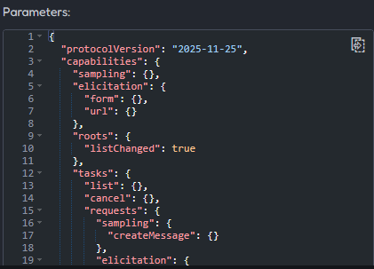
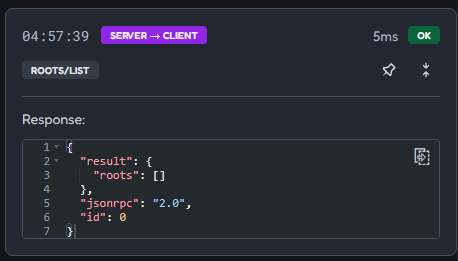
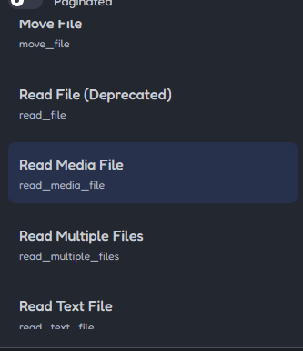
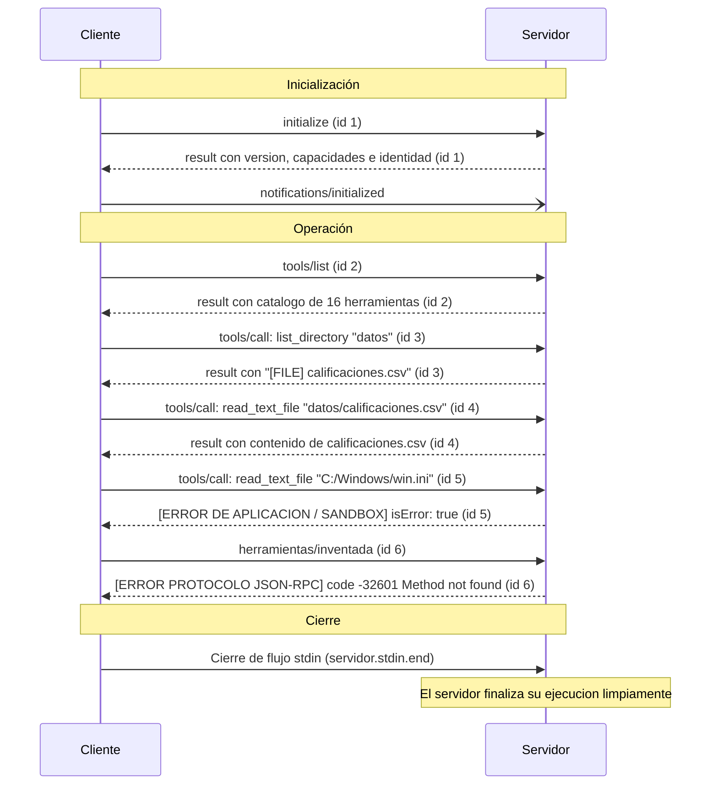

# Práctica 2: Inspección y Pruebas con MCP Inspector y Cliente Personalizado

## Contexto y Configuración Inicial

En esta práctica se profundiza en el funcionamiento interno del protocolo **Model Context Protocol (MCP)** mediante cuatro actividades progresivas:
1. **Actividad A:** Inspección y prueba interactiva a través de la herramienta oficial **MCP Inspector**.
2. **Actividad B:** Construcción y análisis de un **Cliente MCP Mínimo** en Node.js puro usando transporte `stdio`.
3. **Actividad C:** Pruebas de seguridad, contención en sandbox y manejo de errores bajo la especificación JSON-RPC 2.0.
4. **Actividad D:** Comparación del proceso de inicialización, negociación de versiones y capacidades entre clientes.

### 1. Estructura del Proyecto
El proyecto se organizó con la siguiente estructura de directorios:
```text
practica2-mcp/
├── datos/
│   └── calificaciones.csv         # Conjunto de datos de prueba
├── evidencias/                   # Capturas de pantalla del MCP Inspector
├── salida/
│   ├── historial_inspector.json  # Historial exportado desde MCP Inspector
│   └── traza.jsonl               # Traza completa de mensajes de cliente_mcp.mjs
├── cliente_mcp.mjs               # Cliente MCP mínimo en Node.js por stdio
├── mcp.json                      # Configuración del servidor MCP
└── README.md                     # Documentación de la práctica
```

### 2. Configuración del Servidor Filesystem (`mcp.json`)
Se configuró el servidor oficial de sistema de archivos para acceder al directorio actual (`.`):
```json
{
  "mcpServers": {
    "filesystem": {
      "command": "npx",
      "args": ["-y", "@modelcontextprotocol/server-filesystem", "."]
    }
  }
}
```

---

## Actividad 1 (Actividad A): Inspección Interactiva con MCP Inspector

### 1. Apertura de Terminal y Ejecución
Desde la raíz de la carpeta `practica2-mcp`, se abrió la terminal de PowerShell y se ejecutó la herramienta de inspección interactiva:

```bash
npx -y "@modelcontextprotocol/inspector" --config mcp.json
```

Este comando inicia la interfaz web local de MCP Inspector conectándose mediante **STDIO** al servidor `filesystem` definido en `mcp.json`.

---

### 2. Evidencias de Inspección

#### 2.1 Conexión del Servidor
El servidor `filesystem` se conectó con éxito bajo el protocolo MCP vía Standard I/O (STDIO).


---

#### 2.2 Protocol Handshake e Inicialización (JSON-RPC)
Durante la inicialización, cliente y servidor intercambiaron sus capacidades y parámetros según la especificación JSON-RPC 2.0:

- **Capacidades del Cliente (MCP Inspector v2.15.0):**
  Declaró soporte para `sampling`, `elicitation`, `roots` y `tasks`.

  
  

- **Respuesta del Servidor (`secure-filesystem-server` v2.3.0):**
  Confirmó las capacidades disponibles, incluyendo `tools` y `resources`.

  

- **Solicitud y Respuesta de Roots (`roots/list`):**

  

---

#### 2.3 Catálogo de Herramientas Disponibles (Tools)
El servidor expuso un total de **16 herramientas** para operaciones en el sistema de archivos:

1. `append_file`, `copy_file`, `create_directory`, `directory_tree`, `edit_file`
2. `get_file_info`, `list_allowed_directories`, `list_directory`, `list_directory_with_sizes`
3. `move_file`, `read_file` (deprecated), `read_media_file`, `read_multiple_files`, `read_text_file`
4. `search_files`, `write_file`

| Herramientas 1-5 | Herramientas 6-9 |
| :---: | :---: |
|  |  |

| Herramientas 10-14 | Herramientas 15-16 |
| :---: | :---: |
|  |  |

---

#### 2.4 Pruebas y Ejecución de Herramientas
Se probaron de forma interactiva distintas herramientas desde el panel del inspector:

1. **`list_directory`**: Listó el contenido del directorio local identificando el archivo `calificaciones.csv` dentro de la carpeta `datos`.
   

2. **`list_directory_with_sizes`**: Permitió listar los archivos con sus tamaños exactos (`calificaciones.csv` - 160 B).
   

---

### 3. Exportación del Historial y Control de Versiones

Al concluir las pruebas interactivas:
1. Se exportó la sesión completa con el botón **Export** en la interfaz del inspector, guardándose en `salida/historial_inspector.json`.
2. Se registró el avance en Git mediante el commit correspondiente:
   ```bash
   git add .
   git commit -m "Actividad A"
   ```

---

## Actividad 2 (Actividad B): Cliente MCP Mínimo por stdio

### 1. Propósito y Arquitectura
El objetivo de esta actividad fue implementar un cliente MCP nativo en Node.js (sin librerías ni dependencias externas) que se comunique con el servidor mediante transporte **Standard I/O (stdio)**, permitiendo comprender a bajo nivel cómo se serializan, envían y emparejan los mensajes del protocolo **JSON-RPC 2.0**.

### 2. Implementación (`cliente_mcp.mjs`)
El archivo [cliente_mcp.mjs](cliente_mcp.mjs) contiene los componentes esenciales:
- **Transporte stdio:** Proceso hijo lanzado mediante `node:child_process` con `spawn`.
- **Serialización JSON-RPC:** Mensajes enviados línea por línea sobre `stdin`.
- **Recepción asíncrona:** Interfaz `readline` para escuchar eventos `'line'` en `stdout`.
- **Emparejamiento por ID:** Mapa `pendientes` para asociar peticiones (`id`) con sus promesas de respuesta.

---

### 3. Funcionamiento y Emparejamiento de Mensajes

El protocolo MCP opera de forma asíncrona sobre flujos de texto delimitados por saltos de línea (`\n`):

1. **Gestión de Identificadores (`id`)**: Cada llamada a `solicitar(method, params)` genera un `id` secuencial (`1`, `2`, `3`, ...) y registra una función `resolver` de una `Promise` dentro del mapa `pendientes`:
   ```javascript
   pendientes.set(id, resolver);
   ```
2. **Emparejamiento de Respuestas**: Cuando el servidor envía una respuesta a través de su `stdout`, el cliente recupera el resolver usando el `mensaje.id` de la respuesta:
   ```javascript
   pendientes.get(mensaje.id)?.(mensaje);
   ```
   Al ejecutarse `resolver(mensaje)`, se descongela el `await` correspondiente en el hilo principal del cliente.
3. **Notificaciones**: Llamadas como `notifications/initialized` no llevan `id` ni almacenan callbacks en `pendientes`, dado que el servidor no debe emitir respuesta alguna para ellas.

---

## Actividad 3 (Actividad C): Pruebas de Seguridad y Manejo de Errores

### 1. Modificación de la Conversación en `cliente_mcp.mjs`
Se extendió la sección de conversación en [cliente_mcp.mjs](cliente_mcp.mjs) agregando tres solicitudes específicas antes del cierre del proceso (`servidor.stdin.end()`):

```javascript
// 1. Una lectura correcta (leer datos/calificaciones.csv)
await solicitar('tools/call', {
  name: 'read_text_file',
  arguments: { path: 'datos/calificaciones.csv' },
});

// 2. Una lectura prohibida (ruta fuera de la carpeta de la práctica)
await solicitar('tools/call', {
  name: 'read_text_file',
  arguments: { path: 'C:/Windows/win.ini' },
});

// 3. Un método que no existe
await solicitar('herramientas/inventada', {});
```

---

### 2. Análisis Detallado de Resultados

Al ejecutar `node cliente_mcp.mjs`, se analizaron las respuestas recibidas para cada uno de los tres nuevos casos:

#### Caso 1: Lectura Correcta (`id: 4`)
- **Solicitud:** Petición válida para leer `datos/calificaciones.csv` usando la herramienta `read_text_file`.
- **Comportamiento del Servidor:** Accedió al recurso y retornó exitosamente el contenido textual del archivo con el CSV de calificaciones.

#### Caso 2: Lectura Prohibida / Sandbox (`id: 5`)
- **Solicitud:** Intento de lectura de `C:/Windows/win.ini` fuera del directorio de trabajo de la práctica.
- **Comportamiento del Servidor:** El servidor `@modelcontextprotocol/server-filesystem` interceptó la ruta y aplicó su política de seguridad (sandbox), denegando el acceso y marcando `isError: true`:
  ```json
  {
    "result": {
      "content": [
        {
          "type": "text",
          "text": "Access denied - path outside allowed directories: C:\\Windows\\win.ini not in C:\\Users\\elqui\\practica2-mcp"
        }
      ],
      "isError": true
    },
    "jsonrpc": "2.0",
    "id": 5
  }
  ```
  > **Conclusión de Seguridad:** El servidor garantiza que clientes o agentes no puedan escalar permisos ni leer archivos sensibles del sistema anfitrión fuera de la carpeta autorizada (`.`).

#### Caso 3: Método No Encontrado (`id: 6`)
- **Solicitud:** Llamada al método no estándar `herramientas/inventada`.
- **Comportamiento del Servidor:** Siguiendo la especificación JSON-RPC 2.0, el servidor devolvió un objeto de error con código estándar `-32601` (*Method not found*):
  ```json
  {
    "jsonrpc": "2.0",
    "id": 6,
    "error": {
      "code": -32601,
      "message": "Method not found"
    }
  }
  ```

---

### 3. Tabla Cronológica Completa de Mensajes ([salida/traza.jsonl](salida/traza.jsonl))

| Paso | Dirección | Tipo de Mensaje | `id` | Método / Acción | Resultado o Respuesta |
|:---:|:---:|:---:|:---:|:---:|:---|
| **1** | `CLIENTE -> SERVIDOR` | Solicitud | `1` | `initialize` | Versión `2025-06-18`, cliente `cliente-minimo`. |
| **2** | `SERVIDOR -> CLIENTE` | Respuesta | `1` | Resultado `initialize` | `secure-filesystem-server` confirma capacidades. |
| **3** | `CLIENTE -> SERVIDOR` | Notificación | *-* | `notifications/initialized` | Confirmación unidireccional de inicio. |
| **4** | `CLIENTE -> SERVIDOR` | Solicitud | `2` | `tools/list` | Petición del catálogo de herramientas. |
| **5** | `SERVIDOR -> CLIENTE` | Respuesta | `2` | Resultado `tools/list` | Lista de 16 herramientas disponibles con esquemas. |
| **6** | `CLIENTE -> SERVIDOR` | Solicitud | `3` | `tools/call` (`list_directory`) | Listar archivos en `path: "datos"`. |
| **7** | `SERVIDOR -> CLIENTE` | Respuesta | `3` | Resultado `tools/call` | Retorna `[FILE] calificaciones.csv`. |
| **8** | `CLIENTE -> SERVIDOR` | Solicitud | `4` | `tools/call` (`read_text_file`) | Leer archivo permitido `datos/calificaciones.csv`. |
| **9** | `SERVIDOR -> CLIENTE` | Respuesta | `4` | Resultado `tools/call` | Retorna el contenido completo del archivo CSV. |
| **10** | `CLIENTE -> SERVIDOR` | Solicitud | `5` | `tools/call` (`read_text_file`) | Intento de leer `C:/Windows/win.ini`. |
| **11** | `SERVIDOR -> CLIENTE` | Respuesta | `5` | Resultado `tools/call` (`isError: true`) | Bloqueado: *Access denied - path outside allowed directories*. |
| **12** | `CLIENTE -> SERVIDOR` | Solicitud | `6` | `herramientas/inventada` | Método inexistente inventado. |
| **13** | `SERVIDOR -> CLIENTE` | Respuesta de Error | `6` | Error JSON-RPC (`-32601`) | *Method not found*. |
| **14** | - | Cierre | *-* | `servidor.stdin.end()` | Cierre limpio del flujo de entrada del proceso hijo. |

---

### 4. Diagrama de Secuencia de la Sesión Completa (Mermaid)

El siguiente diagrama representa visualmente la sesión completa de `cliente_mcp.mjs`, dividida en sus tres fases, con los 13 mensajes ordenados y la indicación explícita de los dos tipos de errores recibidos:



---

## Actividad 4 (Actividad D): Comparación entre Inspector y Cliente Mínimo

A partir de los archivos de registro [salida/historial_inspector.json](salida/historial_inspector.json) y [salida/traza.jsonl](salida/traza.jsonl), se compararon las fases de inicialización y negociación de capacidades de ambos clientes:

### Tabla Comparativa de Inicialización

| Característica / Pregunta | Inspector (MCP Inspector) | Cliente Mínimo (`cliente_mcp.mjs`) |
|---|---|---|
| **Nombre y versión del cliente (`clientInfo`)** | `name`: `"mcp-inspector"`<br>`version`: `"2.15.0"` | `name`: `"cliente-minimo"`<br>`version`: `"1.0.0"` |
| **Versión del protocolo que propuso el cliente** | `2025-11-25` | `2025-06-18` |
| **Versión del protocolo que respondió el servidor** | `2025-11-25` | `2025-06-18` |
| **Capacidades que declaró el cliente (`capabilities`)** | Declaró múltiples capacidades avanzadas:<br>- `sampling: {}`<br>- `elicitation: { form: {}, url: {} }`<br>- `roots: { listChanged: true }`<br>- `tasks: { list: {}, cancel: {}, requests: { sampling: {}, elicitation: {} } }`<br>- Extensiones: `tasks`, `ui`, `skills` | Declaró un objeto de capacidades vacío:<br>`capabilities: {}` |
| **¿El servidor envió una solicitud al cliente? ¿Cuál?** | **Sí.** El servidor envió la solicitud `roots/list` (`id: 0`, origen: `server`) pidiendo la lista de directorios raíz del cliente. | **No.** El servidor no envió ninguna solicitud hacia el cliente. |

---

### Observaciones y Conclusiones del Protocolo

1. **Negociación Dinámica de Versión:**
   El servidor `secure-filesystem-server` soporta negociación compatible hacia atrás: cuando el Inspector solicitó la versión más reciente `2025-11-25`, el servidor respondió con `2025-11-25`; cuando el cliente mínimo solicitó `2025-06-18`, el servidor aceptó trabajar en esa versión.
2. **Comunicación Bidireccional basada en Capacidades:**
   En MCP, el servidor no sólo responde consultas sino que también puede actuar como llamador (caller) hacia el cliente si este cuenta con las capacidades adecuadas. Debido a que el Inspector declaró `"roots": { "listChanged": true }`, el servidor emitió la solicitud `roots/list`. En contraste, al declarar capacidades vacías (`{}`), el cliente mínimo sólo recibió respuestas a sus propias solicitudes.

---

### Experimento: Negociación con Versión Inexistente (`1999-01-01`)
Para evaluar la robustez del servidor ante clientes con versiones incompatibles o desconocidas:
- Se modificó temporalmente el cliente con:
  ```javascript
  protocolVersion: '1999-01-01'
  ```
- **Respuesta del Servidor:**
  El servidor no rechazó la conexión ni produjo un error. En su lugar, hizo fallback respondiendo con su versión estándar soportada más reciente: **`2025-11-25`**.
- **Restauración:**
  Posteriormente se restauró el valor `protocolVersion: '2025-06-18'` en `cliente_mcp.mjs` y se reejecutó el cliente para mantener la traza consistente con la Actividad C.

---

### Control de Versiones
El avance de la Actividad D fue registrado en Git mediante el commit:
```bash
git add .
git commit -m "Actividad D"
```
